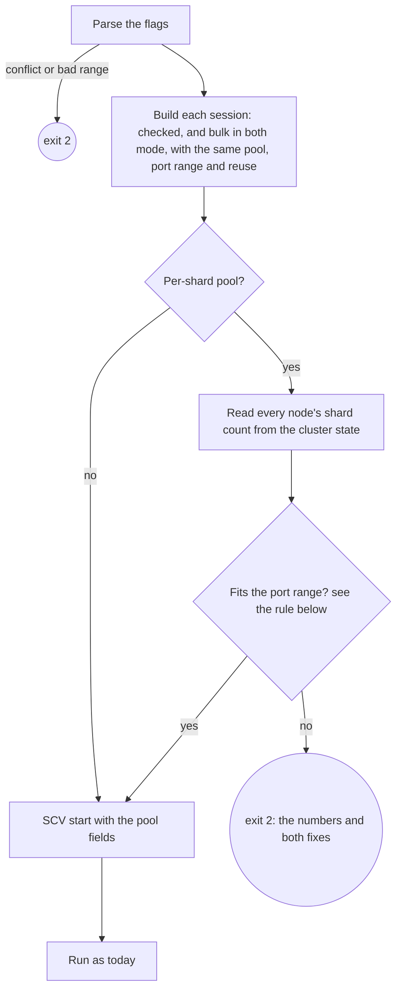

# SCYLLADB-5406 — many driver connections per shard in the verified load

**Parent**: SCYLLADB-4519 · `cql-stress:tasks/SCYLLADB-4519/spec.md`

Design source: the sc-verify spec (`docs/SPEC-sc-verify.md` in the tracking
repository, Confluence 479887448), §14.4, §14.5, §15.2, §15.3 and the new
§15.4 "Connections". When the two disagree, that spec is fixed first.

## Overview

`cql-stress-sc-verify` gets the four connection options of the
cassandra-stress front end, in its own kebab-case: `--connections-per-shard`,
`--connections-per-host`, `--shard-aware-port-range` and
`--tcp-reuse-address`. Every driver session of the run, checked and bulk, is
built with them. After connecting, the tool checks that a per-shard pool fits
its local port range and exits 2 when it doesn't. The `start` line records the
settings the sessions used. With no new option given, the run behaves as
today.

## Constraints

- `cql-stress-cassandra-stress` keeps its CLI, output and exit codes
  byte-for-byte (parent constraint).
- The verifier's validation and error text for the port range match
  cassandra-stress: an inclusive `a..b`, non-empty, starting at 1024 or
  above.
- The `SCV` contract stays add-only: new `start` fields, nothing renamed or
  removed (§14.4).
- The checked path keeps its rules: no retries, no speculative execution,
  one monotonic clock (parent constraints). The pool changes only how many
  connections carry the same requests.

## Design



The fit rule (§15.4), with S the number of sessions (1 in `verify` and
`bulk`, 2 in `both`), n the pool size, and P the number of ports in the range:

| `--tcp-reuse-address` | The pool fits when |
|---|---|
| `false` (default) | S × (shards of all nodes) × n ≤ P |
| `true` | S × (shards of the node) × n ≤ P, for every node |

| Condition | Behavior |
|---|---|
| `--connections-per-shard` and `--connections-per-host` both given | Rejected while parsing, exit 2 |
| `--shard-aware-port-range` with `--connections-per-host` | Rejected while parsing, exit 2 |
| A pool size of 0, an empty range, or a range starting below 1024 | Rejected while parsing, exit 2 |
| A node reports no shard information | Its connections are not shard-aware and use no port of the range; the node doesn't count toward the fit |
| The per-shard pool doesn't fit | Exit 2 after connecting, before any schema change or operation |

## Contracts

### Inputs

```
Session::get_cluster_state().get_nodes_info()    # per node: sharder().nr_shards, or none
```

### Outputs

The command (§15.2):

```text
--connections-per-shard <n>          default 1, n ≥ 1; excludes --connections-per-host
--connections-per-host <n>           n ≥ 1
--shard-aware-port-range <a>..<b>    default 49152..65535, inclusive, a ≥ 1024; per-shard pool only
--tcp-reuse-address true|false       default false
```

The `start` line, every mode (§14.4); the values the sessions used, defaults
included:

```text
SCV {"t":"start","mode":"verify",...,"pool":"per-shard","pool_size":4,"shard_aware_port_range":"49152..65535","tcp_reuse_address":false}
SCV {"t":"start","mode":"bulk",...,"pool":"per-host","pool_size":8,"shard_aware_port_range":null,"tcp_reuse_address":true}
```

The start-up failure (exit 2, §15.3 check 5):

```text
error: the per-shard pool needs 2 sessions × 84 shards × 100 = 16800 local ports, and --shard-aware-port-range 49152..65535 has 16384; widen the range or set --tcp-reuse-address true
```

## Risks

| Risk | Response |
|---|---|
| The driver picks a shard-aware port by its remainder modulo the node's shard count, so with mixed shard counts the real limit is below the fit rule | The rule is a necessary bound; a shortfall shows in the driver log as failed connections. The SCT clusters use one instance type. |
| Many connections exhaust file descriptors before ports | SCT runs the tool with `--ulimit nofile=65536`; 2 × 84 × 195 = 32,760 stays under it. Larger pools need a larger limit. |
| A row's requests now spread over several connections to one shard | Expected and wanted: it is the case under test. Verdicts keep their meaning; the checker sees the same history shape. |

## Deferred work

- The SCT configs that use the options, after an image with them exists.
- Different pools for the checked and bulk sessions: the flags are shared
  now, and a per-session flag can be added later without changing these.

## Decisions

- Every session of the run, checked and bulk, uses the same pool settings
  (user, 2026-10-15). (spec)
- The flag names and rules mirror the cassandra-stress `-mode` options, in
  the verifier's kebab-case (user, 2026-10-15). (spec)
- The `start` line records the pool settings in every mode, so no result is
  read without its connection count (user, 2026-10-15). (spec)
- A per-shard pool that doesn't fit its port range fails start-up with exit
  2, so no run continues with fewer connections than it claims (user,
  2026-10-15). (spec)
- The tracking spec changed first: §14.4, §14.5, §15.2, §15.3 and the new
  §15.4. (spec)
