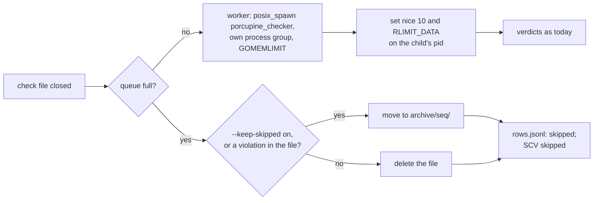

# SCYLLADB-5659 — the checker falls behind on a busy loader and skipped files fill its disk

**Parent**: SCYLLADB-4519 · `cql-stress:tasks/SCYLLADB-4519/spec.md`

## Overview

The tool starts each `porcupine_checker` child with `posix_spawn` instead of
`fork()`. Then it sets the child's `nice 10` and `RLIMIT_DATA` from outside,
by pid, right after the start. Starting a check no longer copies the tool's
memory, so its cost doesn't grow with the tool's size or stall the tool's
threads. A check file the queue can't take is deleted. Its rows are still
recorded, counted and reported as `skipped`. The new `--keep-skipped on`
keeps such files in `archive/` as today.

## Constraints

- **The child keeps its limits** (parent design, milestone 2): its own
  process group, `nice 10`, `GOMEMLIMIT` at `--checker-mem`, and
  `RLIMIT_DATA` at 1.25 × `--checker-mem`. Never `RLIMIT_AS`.
- **Starting a check doesn't scale with the tool:** its cost must not depend
  on the tool's memory or thread count.
- **porcupine_validator is untouched:** no change to the checker or its
  image.
- **A skipped row is never a pass.** It stays in `rows.jsonl`, in
  `report.json` (`rows_skipped`) and in an `SCV skipped` line, as today.
- **The tracking spec changes first:** `docs/SPEC-sc-verify.md`, §4.3, §5.3,
  §11.3, §14.4, §15.2 and §23 (sc-verify tracking repository).

## Design

### The cause, measured

A standalone program held touched heap, kept 8 threads writing to it, and
started `/bin/true` 2,000 times, one after another. It ran once with the tool's
current `pre_exec` hook and once with only a process group set.

| Start | Held memory | Starts/s | Kernel CPU | Writes/s of the busy threads |
|---|---|---|---|---|
| `pre_exec` → `clone(SIGCHLD)`, a fork | 1 GiB | 10 | 1,028 s | 4.6 M |
| process group only → `clone3(CLONE_VM\|CLONE_VFORK)`, `posix_spawn` | 1 GiB | 355 | 0.5 s | 151 M |
| process group only, `posix_spawn` | 4 GiB | 504 | 0.4 s | 129 M |

- **What the fork costs:** it copies the page tables and turns the parent's
  memory copy-on-write, so every thread that writes afterwards takes faults.
- **Why it matched the run:** this is the kernel CPU, the starved checker and
  the growing scheduling delay that run 95a8ee10 showed.
- **Why `posix_spawn` is safe:** the Rust standard library uses it when the
  command has no `pre_exec` hook. A process group set with `process_group`
  doesn't block it.

### A closed check file



Files still queued when `--checker-deadline` ends the drain take the
`queue full` branch, as today.

### Failure behaviour

| Condition | Behavior |
|---|---|
| Setting the priority or the limit fails with `ESRCH`: the child already exited | Nothing to do |
| Setting either fails another way | One warning line for the run. The check goes on. `GOMEMLIMIT` still bounds the child |
| The child can't be started | As today: its rows are `unknown` |
| Deleting a skipped file fails | An error line and exit 3, as a failed archive move is today |

## Contracts

### Outputs

The command line (spec §15.2):

```
--keep-skipped on|off    default off. on: a skipped check file moves to archive/<seq>/.
                         off: it is deleted. Its rows are recorded either way, and a
                         file that holds a violation is always kept.
```

`SCV` lines (spec §14.4). `archive` appears only when the file was kept, as
on `checked` lines:

```text
SCV {"t":"skipped","file":"40","rows":50}
SCV {"t":"skipped","file":"41","rows":50,"archive":"archive/41"}
```

Unchanged:

- **`rows.jsonl`:** a skipped row keeps its `file` field, which names a
  deleted file under `--keep-skipped off`.
- **`report.json`** and the `start` line.
- **The child's command line and environment.**

## Risks

| Risk | Response |
|---|---|
| The child runs a moment before its priority and data limit are set | The window is the exec and the Go start-up. `GOMEMLIMIT` holds from the first instruction, and the checker reads its input before it allocates much |
| A later change to the checker command brings back a fork: a `pre_exec` hook, or a uid, gid or chroot | A comment on the command says why it must stay `posix_spawn`. Review keeps it |
| The run's drift has a second cause: the tool's memory also grew from 4.0 to 6.4 GiB in 95a8ee10 | The plan's soak check compares starts per second and `sched_delay_p99_ms` over time. A drift left over becomes its own issue |
| Someone needs the skipped histories later | `--keep-skipped on`. The counts still show how much went unchecked |

## Deferred work

Long-lived checker workers, where one process checks many files, would also
save the exec and Go start-up per file. They aren't needed while a cheap
file takes about 10 ms of checking and starts run at hundreds per second.
The boundary stays: one check file in, its verdicts out.

## Decisions

- A skipped check file is deleted by default, and `--keep-skipped on` keeps
  it. Its rows stay recorded and counted. (spec)
- The tool sets `nice 10` and `RLIMIT_DATA` on the child from outside,
  right after starting it. No wrapper process, no checker change. (spec)
- A failure to set the priority or the limit warns once and keeps the
  check. A missed check costs more than a child at normal priority. (spec)
- `SCV skipped` names the archive only for a kept file, with the field the
  `checked` line already uses. (spec)
- The cause was confirmed with a standalone measurement, not on a loader.
  The plan checks the fix on a loader-like run. (spec)
- A skipped file that holds a violation is archived whatever `--keep-skipped`
  says: `archive/<seq>/` already holds its evidence from the seal. (build)
- Whether `--keep-skipped on` also needs a size limit. (open)
