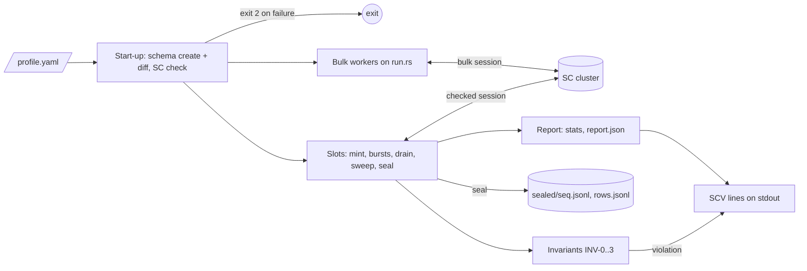
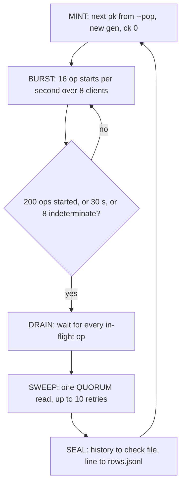
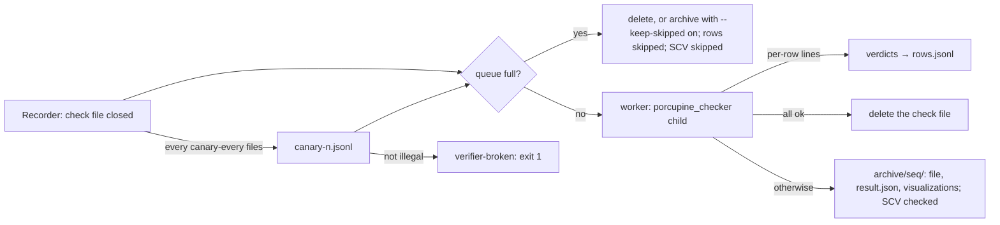

# SCYLLADB-4519 — `cql-stress-sc-verify`, milestone 1

Design source: [sc-verify spec](https://scylladb.atlassian.net/wiki/pages/viewpage.action?pageId=479887448)
(Confluence 479887448). Section numbers (§N) below refer to it. This file
states what the cql-stress repository builds for milestone 1 (M1). When the
two disagree, the Confluence spec is fixed first.

## Overview

A new binary, `cql-stress-sc-verify`, drives a strongly consistent (SC) table
from one YAML profile. In `verify` mode, 32 slots each work one fresh row
`(pk, gen, ck)` at a time. A slot's 8 clients fire bursts of overlapping
QUORUM reads and writes, with no retries. Every write stores its write id
(wid) in the cells it sets. Every read is checked at once by four streaming
invariants. After the drain and a final sweep read, the row is sealed: its
history goes to a check file and its summary to `rows.jsonl`. In `bulk` mode,
the existing `run.rs` loop drives plain, unchecked load. `both` runs the two
together. The SC keyspace check and the population parsers move from the
cassandra-stress binary into the library first, so both binaries share them.

## Constraints

- `cql-stress-cassandra-stress` keeps its CLI, output and exit codes
  byte-for-byte. Its unit tests and `cs_args_*_test.in` files pass unchanged.
- `run.rs` behaviour does not change: the daily performance runs depend on it.
- The new binary exists only in builds with the `strong-consistency` feature,
  which needs `RUSTFLAGS="--cfg scylla_unstable"`.
- On the checked path: no retries in the driver or the tool, no speculative
  execution, statements not idempotent, CL `QUORUM` or `LOCAL_QUORUM` (§8.3).
- All operation times come from one monotonic clock in the process (§8.4).
- `gen` exceeds 2^53, so every JSON file writes it as a string (§7.3).

## Design



A round of one slot (§8.2):



Outcome classes (§9). When in doubt, a write's outcome is unknown:

| Outcome | Recorded as |
|---|---|
| Success | call + return, `status: ok` |
| Write timeout, unknown-outcome server error, client timeout, broken connection, no host | indeterminate write: call only, no return |
| `Unavailable` | indeterminate; with `--unavailable-is-fail`, return `fail` and the wid is burned |
| `InvalidRequest`, syntax error, unauthorized | not recorded; counted; exit 3 after `--max-workload-errors` |
| Any failed read | not recorded |
| Read finds no row | return with every cell `null` |

Invariants (§10.2), checked per cell of every recorded read. Floors are copied
before the read's start time is taken, and an operation updates the floors only
after it has taken its end time (§10.1):

| Id | Fires when |
|---|---|
| INV-0 | the wid was never issued, was burned, or does not decode |
| INV-1 | null although an acknowledged write had ended before the read began, or the wid ended before `ack_floor` |
| INV-2 | null although an earlier finished read saw a value, or the wid ended before `obs_floor` |
| INV-3 | the wid also set cell *d*, and *d* is null or holds a wid that ended before this wid started |

An indeterminate write has an end of infinity, so it is never "definitely
older".

Failure behaviour:

| Condition | Behaviour |
|---|---|
| Live table differs from the profile | exit 2 with a per-column diff, nothing written |
| Driver does not report the keyspace as `Global` | exit 2 with `STRONG_CONSISTENCY_UNAVAILABLE` |
| An invariant fires | `SCV violation` line at once; the row is kept in `archive/`; the slot goes on; exit 1 at the end |
| Sweep fails 10 times | row sealed with `sweep: incomplete` |
| Indeterminate writes reach `--max-indeterminate` | no new starts; drain; seal with `stop_reason: indeterminate` |

## Contracts

### Inputs

Profile (§15.1), the only schema definition:

```yaml
keyspace: sc_verify
replication_factor: 3
tablets_initial: 128
table: reg
cells: [bigint, text, blob]       # 1..8 of int, bigint, text, blob
text_size: 32
blob_size: 64
bulk_table: null
```

Command (§15.2; M1 subset). The M2 checker and read-back flags are deferred:

```text
cql-stress-sc-verify --profile <file> --mode verify|bulk|both
  --nodes <host[:port],...> --user <u> --password <p>
  --ssl [--ssl-ca <pem>] [--ssl-cert <pem> --ssl-key <pem>]
  --consistency quorum|local-quorum
  --duration <30s|5m|4h> | -n <ops>        one is required; -n only with --mode bulk
  --pop --slots --clients-per-row --ops-per-gen --max-gen-duration
  --burst-ops --burst-interval --read-ratio --insert-ratio --request-timeout
  --sweep-retries --sweep-backoff --max-indeterminate --unavailable-is-fail
  --max-workload-errors --ttl --history-dir --check-rows --check-age
  --checker off --report-interval
  --bulk-op write|read|mixed --bulk-read-ratio --bulk-pop --bulk-threads
  --bulk-rate --bulk-read-consistency quorum|one --bulk-retries
```

### Outputs

Schema (§7.1), created with `IF NOT EXISTS` by every mode:

```sql
CREATE KEYSPACE sc_verify WITH replication = {'class': 'NetworkTopologyStrategy', 'replication_factor': 3}
  AND tablets = {'enabled': true} AND consistency = 'global';
CREATE TABLE sc_verify.reg (pk bigint, gen bigint, ck int, c0 bigint, c1 text, c2 blob,
  PRIMARY KEY ((pk), gen, ck)) WITH tablets = {'min_tablet_count': 128};
```

Keys: checked `gen = start_unix_ms × 2^20 + n` (≥ 2^60); bulk `gen = f(pk) < 2^40`.
Write ids count from 1 within a row and stay below 2^63. Cell encodings (§7.2):
`bigint`/`int` = wid (`int` below 2^31); `text` = `"<wid>:"` + filler to
`text_size`; `blob` = wid as 8 bytes little-endian + filler to `blob_size`.

History, check file `sealed/<seq>.jsonl` (§14.1, format v2, owned by porcupine_validator):

```jsonl
# key 0 pk 7 gen "1882..." ck 0
{"id":1,"client_id":0,"kind":"call","op":"write","key":0,"cells":[1,1,1],"time_ns":1000}
{"id":1,"client_id":0,"kind":"return","op":"write","key":0,"time_ns":1900,"status":"ok"}
{"id":2,"client_id":1,"kind":"call","op":"write","key":0,"cells":[2,null,2],"time_ns":1500}
{"id":3,"client_id":2,"kind":"call","op":"read","key":0,"time_ns":1600}
{"id":3,"client_id":2,"kind":"return","op":"read","key":0,"cells":[1,1,1],"time_ns":2100,"status":"ok"}
```

`rows.jsonl`, one line per sealed row (§14.3). In M1 `verdict` is
`violation` or `unchecked`:

```json
{"pk":7,"gen":"1882...","ck":0,"slot":3,"file":"12","key":17,"wall_start_ms":0,"wall_end_ms":0,
 "ops":137,"reads":70,"writes_ok":57,"writes_indet":10,"errors":0,"max_gap_ms":1840,
 "stop_reason":"ops|time|indeterminate|end","invariants":"ok","sweep":"ok|incomplete","verdict":"unchecked"}
```

`SCV` lines on stdout (§14.4). M1 prints `start`, `violation`, `stats`, `end`:

```text
SCV {"t":"start","mode":"both","pop":"seq=0..2047","slots":32,"gen_base":"..."}
SCV {"t":"violation","kind":"INV-3","pk":7,"gen":"...","cell":"c1","wall_ms":1791293683732,"archive":"archive/12"}
SCV {"t":"stats","verified_ops_s":0,"bulk_ops_s":0,"read_p99_ms":0,"write_p99_ms":0,"indet_pct":0,"sched_delay_p99_ms":0}
SCV {"t":"end","exit":0}
```

`report.json` holds the totals and is rewritten every `--report-interval` and
at exit. Exit codes (§14.5): 0 clean, 1 violation, 2 setup failure, 3 too many
tool or profile errors (or a crashed slot). When several apply, the highest wins.

### Module API

Library, new module `cql_stress::strong_consistency` (feature `strong-consistency`),
moved from the cassandra-stress binary:

```rust
pub const STRONG_CONSISTENCY_UNAVAILABLE_CODE: &str = "STRONG_CONSISTENCY_UNAVAILABLE";
/// Refreshes metadata, then returns the driver's view of the keyspace; None = absent.
pub async fn keyspace_consistency_mode(session: &Session, keyspace: &str) -> Result<Option<ConsistencyMode>>;
/// The start-up failure: carries the code and the per-node TABLETS_ROUTING_V2 diagnosis.
/// `tls`: the probe speaks plaintext CQL, so a TLS run is told the nodes were not asked.
pub async fn unavailable_error(keyspace: &str, reported_mode: &str, ddl: &str, nodes: &[String], tls: bool) -> anyhow::Error;
pub async fn fetch_protocol_features(node: &str) -> Result<ProtocolFeatures>;
```

Library, `cql_stress::java_generate::distribution`, moved unchanged with the
`Distribution` and `DistributionFactory` traits, plus the population parser:

```rust
/// "seq=a..b" (inclusive) or "dist=<distribution>", as cassandra-stress -pop accepts it.
pub fn parse_population(s: &str) -> Result<Box<dyn DistributionFactory>>;
```

## Risks

| Risk | Response |
|---|---|
| scylla-rust-driver 1.9.0 cannot turn off retries or speculative execution per session | Checked first, with a unit test on the execution profile. If there is a gap, stop and ask before any workaround. |
| The library move changes cassandra-stress behaviour | The move is mechanical; the golden files and unit tests must pass unchanged. |
| Bulk in `both` stretches the checked operation times | Separate driver sessions; the calibration run (§22) compares write p99 with `verify` alone. |
| An overloaded loader stretches operation times | `sched_delay_p99_ms` in every `stats` line. |

## Milestone 2 — the checker, canaries and the read-back

Branch `feat/sc-verify-m2` (cut from `feat/sc-verify-m1`). Design source: Confluence
§11.3, §11.4, §12, §14.

### Overview

With `--checker on` (the M2 default), every closed check file goes to a bounded queue.
`--checker-workers` workers each run `porcupine_checker` (porcupine_validator `checker-v2`)
as a child process on one file, with a time limit and a memory limit. The child's per-row
lines become the rows' verdicts; a row without a line is `unknown`. Every `--canary-every`
files, a one-row copy of a history with its first read corrupted goes through the same
queue, and must come back `illegal`. At seal every row also records the set of values each
cell may still hold (`expected.jsonl`). At the end of the run the queue drains, then every
retired row is read back once and judged: `ok`, `lost` or `phantom`.



### Constraints

- The checker never slows the load: the queue is bounded (a full queue means `skipped`,
  never waiting); children run at `nice 10`; a hung child is killed after
  `--checker-timeout`. A child starts by `posix_spawn`, never a fork of the tool, and the
  tool sets its `nice 10` and `RLIMIT_DATA` right after (SCYLLADB-5659).
- Memory: `GOMEMLIMIT` plus `RLIMIT_DATA` for the child, never `RLIMIT_AS` (the Go runtime
  reserves address space up front).
- A row's `rows.jsonl` line is written once its verdict is final: at seal with
  `--checker off` (as in M1), after its file is checked with `--checker on`.
- Severity when several apply: `violation` > `lost`/`phantom` > `illegal` > `unknown` >
  `skipped` > `unchecked` > `ok`. Read-back results go to `readback.jsonl` and
  `report.json`, not to `rows.jsonl` (§4.3).

### Failure behaviour

| Condition | Behaviour |
|---|---|
| `--checker on` but `--checker-bin` cannot run | exit 2 at start-up |
| Queue full | the file is deleted, or goes to `archive/<seq>/` with `--keep-skipped on` or when it holds a violation; its rows are `skipped`; `SCV skipped` |
| Child killed (timeout or memory) | rows with a line keep it; the rest are `unknown` |
| A canary answered `ok` or `unknown` | `verifier-broken`: `SCV canary`, exit 1 |
| End of run | the queue drains until `--checker-deadline`; files left are `skipped` |
| Read-back of a row fails after retries | counted as `incomplete`; the exit code does not change |
| A cell outside its expected set | `lost` (null, or a wid this row issued) or `phantom` (never issued, burned, undecodable): exit 1 |

### Contracts

Command additions (§15.2):

```text
  --checker on|off  --checker-bin /usr/local/bin/porcupine_checker
  --checker-workers 2  --checker-timeout 600s  --checker-mem 4G  --checker-deadline 10m
  --queue-max 256  --keep-skipped off  --canary-every 100  --key-timeout 10s  --max-viz 3
  --readback on|off  --readback-sample 1.0  --readback-concurrency 64
```

Child process: `porcupine_checker --output-dir <history>/archive/<seq> --key-timeout <t>
--max-viz <n> < sealed/<seq>.jsonl`, environment `GOMEMLIMIT=<checker-mem>`.

`expected.jsonl`, one line per row at seal (§12.1); `cells[i]` is the set of values cell i may
still hold (`null` = empty):

```json
{"pk":7,"gen":"1882...","ck":0,"cells":[[3,9],[null,4]],"max_wid":12,"burned":[5],"indeterminate":[9]}
```

`indeterminate` lists the row's timed-out writes, so the read-back can count those that
landed. `readback.jsonl`, one line per failing cell, and one per row that could not be read
(`"result":"incomplete"`):

```json
{"pk":7,"gen":"1882...","ck":0,"cell":"c1","expected":[null,4],"observed":11,"result":"phantom"}
```

New `SCV` lines (§14.4):

```text
SCV {"t":"checked","file":"12","ok":49,"illegal":1,"unknown":0,"archive":"archive/12"}
SCV {"t":"skipped","file":"40","rows":50}
SCV {"t":"skipped","file":"41","rows":50,"archive":"archive/41"}
SCV {"t":"canary","result":"illegal"}
SCV {"t":"readback","rows":70112,"ok":70112,"lost":0,"phantom":0,"incomplete":0,"indet_total":913,"indet_landed":402}
```

`stats` lines gain `"queue":<files waiting>`, `"wall_ms"` (when the line was printed) and
`"failed_ops_s"` (failed reads, the sweep's too, `fail` writes and workload errors).
`report.json` gains, for SCT's Argus table:
`rows_ok`, `rows_illegal`, `rows_unknown`, `rows_skipped` (row verdicts from the checker);
`checker_illegal` (rows the checker judged illegal, including those whose verdict is
`violation`);
`canaries_ok`, `canaries_failed`, `canaries_skipped`; and `readback`, which is null until
the read-back ran, then `{rows, ok, lost, phantom, incomplete, expired, indet_total,
indet_landed}` (`expired`: rows older than `--ttl`, not read).

### Deferred work

The later phases (§17) need `ck`, which stays 0. `indet_landed` is a run total; splitting
it by quiet and disrupted rows is SCT's job from `expected.jsonl` and `readback.jsonl` and is
left to T25.

## Positive controls

Confluence §20.5, "Positive controls": show that the verifier finds real linearizability
errors of each kind and stays quiet on legal histories, on local clusters with a ScyllaDB
2026.4 nightly. The tracking design is `work/phase-7-positive-controls/00-design.md`.

- **Mutation matrix.** `tools/sc_verify_mutate.py` takes a real check file and injects one
  anomaly into a chosen row, deterministically (the first eligible ops in op order):
  `stale`, `torn`, `backwards`, `future`, `phantom`, each illegal by construction; and the
  negative controls `identity`, `drop-read`, `unack-write` (an acknowledged write's return
  line dropped), `shift` (all times shifted). The pytest records a quiet `--checker off`
  run, mutates each class into its own file, runs `porcupine_checker`, and wants: mutated
  rows `illegal`, all other rows `ok`, empty checker stderr.
- **`--fault-replay-writes <p>`** (hidden, test-only, default 0): right after a write is
  acknowledged and recorded, with probability p the client resends, unrecorded and with its
  result ignored, the newest older acknowledged write of the row that a newer acknowledged
  write has superseded on at least one cell. Expected: violations, `checker_illegal` > 0,
  exit 1, a clean read-back.
- **`--unsafe-eventual`** (hidden, test-only): the keyspace DDL leaves out
  `consistency = 'global'`; the start-up check requires the keyspace NOT to be strongly
  consistent instead; `--consistency one` is accepted (rejected without the flag). Used on
  a local 3-node cluster with hinted handoff off and a node stopped under load: the
  read-back at ONE finds `lost` > 0.

## Decisions

- One task directory covers all CS work for SCYLLADB-4519; the small steps live in `plan.md`, not in Jira subtasks. (spec)
- The Confluence spec is the design source; this file condenses the part that cql-stress builds. (spec)
- `unavailable_error` takes the reported mode as text and a `tls` flag, so the cassandra-stress message stays the same for TLS runs. (build)
- One spec for all of M1, not split off for the T1/T2 library move: Confluence §6 sets one PR per repo per milestone. (review)
- M1 and M2 ship in one PR, #206: it already held every M1 commit, and SCT builds directly on M2. #205 (M1 alone) was closed; Confluence §6 now makes cql-stress the exception to one PR per milestone. (user, 2026-10-07)
- `clap` is added for the new binary's CLI (user, 2026-09-25). (spec)
- The binary has `required-features = ["strong-consistency"]`, and that feature also turns on `serde`, `serde_yaml` and `clap`. A default build stays as it is. (spec)
- TLS is in M1: `--ssl` with PEM files through `openssl`. The server certificate is verified only when `--ssl-ca` is given, as in cassandra-stress (user, 2026-10-06). (spec)
- A read cell that does not decode is written to the history as wid `-1`, which is never issued, so the checker cannot explain that read either; `null` would hide it. (build)
- When several exit codes apply, the highest wins: 3 over 2 over 1. A run whose tool failed cannot vouch for its verdicts, which is worse than a finding. (build)
- `--ttl` above 0 must cover 10 rounds of the longest possible length: `max_gen_duration + request_timeout + sweep_retries × (sweep_backoff + request_timeout)` (§7.4). (build)
- The `SCV violation` line is printed when the row seals, once its check file is in `archive/<seq>/`, so SCT can copy the evidence before it raises the event; `wall_ms` says when the read exposed the violation, so SCT still places it next to the nemesis that caused it. A human-readable line is printed at detection. The event is up to one row's life (about 13 s) late; SCT handles it by severity (user, Checkpoint B). (review)
- `stats` lines cover one `--report-interval`; latencies are p99 of successful operations; `sched_delay_p99_ms` is how late the slots' burst ticks ran. (build)
- In `rows.jsonl`, `errors` counts failed reads, `fail` writes and workload errors; indeterminate writes are counted only in `writes_indet`. (review)
- **M2, a deliberate break:** `--checker on` is the default, so a checked run needs `porcupine_checker` at `--checker-bin` (the strong consistency image ships it). An M1-era command without `--checker off` exits 2 at start-up where no checker is installed; SCT passes `--checker off` explicitly for an M1 image. (spec)
- **M2:** `--checker on` is the default. The canary corrupts the first read's first cell to the row's highest issued wid + 1, which no write produced, so the check fails at that read and costs almost nothing. (spec)
- **M2:** with `--checker on`, a row's `rows.jsonl` line is written when its file has been checked. A kill loses the lines of rows whose file was still queued (their histories stay in `sealed/`), so after a kill `rows.jsonl` is not a complete list; at a normal end every row gets a line (`skipped` past `--checker-deadline`). (spec)
- **M2:** with `--ttl`, the read-back skips a row once it started more than 0.9 × TTL ago, judged just before reading it: a cell may be as old as the row, and an expired cell must never be judged `lost`. They are counted as `expired`. (review)
- **M2:** a restarted process never reuses a check-file number: the next is one above the highest in `sealed/`, `archive/` and `rows.jsonl`; canaries are named after their source file. (review)
- **Positive controls:** the replayed write is the one deliberate retry on the checked path, test-only and hidden; the eventually consistent mode is test-only and hidden too. Neither is ever set by SCT (Confluence §20.6). (user, 2026-10-07)
- **Positive controls:** a fake-ack fault (a write recorded but never sent) is left out: it is tool-made, and the deleted-row test already covers `lost`. (spec)
- **M2:** the test-only `--fault-stale-reads` applies to the clients' reads, never to the sweep: the expected state is built from what the sweep saw, so a stale sweep would make the read-back report rows `lost` that the database kept (local validation, finding 1). (review)
- **M2:** `report.json` counts the checker's illegal rows in `checker_illegal`, apart from the rows' verdicts: a violation outranks the checker's verdict, so `rows_illegal` alone hides that the checker caught the same rows (local validation, finding 3). (review)
- **M2:** every `stats` line carries `wall_ms`, the time it was printed: SCT places the intervals next to nemesis events without guessing from the report cadence (local validation, finding 4). (review)
- **M2:** `stats` lines count failed operations in `failed_ops_s`, defined as `errors` in `rows.jsonl`, apart from `verified_ops_s`, which keeps counting completed ones: without it an outage showed 0 ops/s with nothing failing (local validation, finding 5). (review)
- **M2:** the profile's `tablets_initial` becomes the table's `min_tablet_count`, and the keyspace only enables tablets: ScyllaDB deprecates the keyspace's `initial` option and warns on every start. Tables created before keep their tablets; the column check does not look at the tablet count (local validation, finding 8). (review)
- **M2:** the Dockerfile pins the checker image by digest, and a `strong-consistency` build fails unless the copied checker runs (exit 2 on empty input), so a checker of the wrong architecture cannot ship. The checker image is amd64-only for now, so the strong consistency image is too; arm64 waits for a multi-arch checker image, and the image moves to the `scylladb` organisation once porcupine_validator PR #5 merges. (review)
- M1 accepts only `--checker off`, so SCT commands written for M1 stay valid in M2. (spec)
- The moved code keeps its names, except that `diagnose_missing_strong_consistency` becomes the free function `diagnose_v2`. One `#[cfg(feature = "strong-consistency")]` on the library module replaces the per-item gates. The parts specific to cassandra-stress stay in that binary: the CL check and the datacenter warning. (review)
